# PROP-CONNECT

PROP-CONNECT is a real-estate platform for finding and verifying properties in
Nigeria. The frontend is built with React, TypeScript, Vite, and Tailwind CSS.

## Architecture

The diagram shows the prepared integration and build pipeline. Local development
uses the independent Supabase configuration; production deployment settings have
not been switched. The owner reports successful registration, email confirmation, profile creation
and manual testing of exercised functionality. Case-specific automated
authenticated feature/security acceptance remains pending.
Verify the intended Supabase project and Auth redirect URLs before changing targets.

```mermaid
flowchart TB
  Visitor["Visitors, buyers, agents, and admins"]

  subgraph Build["Local development and build"]
    Npm["npm and package-lock.json"]
    Config["Shared site URL configuration<br/>VITE_SITE_URL or SITE_URL"]
    Vite["Vite and TypeScript frontend build"]
    Generator["Node.js sitemap and robots generator"]
    Npm --> Vite
    Npm --> Generator
    Config --> Vite
    Config --> Generator
  end

  subgraph Web["Frontend hosting and browser"]
    Static["Static assets, sitemap.xml, and robots.txt"]
    React["React and React Router<br/>Public pages and protected dashboards"]
    Seo["SEO URL helpers and React Helmet<br/>Canonical, social, and structured-data URLs"]
    Client["Supabase JavaScript client"]
    Preview["Standard Supabase Auth<br/>Browser session storage"]
    React --> Seo
    React --> Client
    Client --- Preview
  end

  subgraph Backend["Configured Supabase project - no automatic cutover"]
    Auth["Authentication and registered users"]
    Database["PostgreSQL<br/>Application records, views, RPCs, and RLS"]
    Storage["Storage<br/>Property images, documents, and attachments"]
    Functions["Edge Functions<br/>AI and phone OTP; account deletion locked"]
  end

  Gateway["Approved AI-compatible provider - disabled by default"]
  Twilio["Twilio SMS"]

  Vite --> Static
  Generator --> Static
  Static --> React
  Visitor --> React
  Client --> Auth
  Client --> Database
  Client --> Storage
  React -->|"Authenticated requests"| Functions
  Functions --> Auth
  Functions --> Database
  Functions -->|"prop-ai"| Gateway
  Functions -->|"send-phone-otp"| Twilio
```



Frontend hosting and SEO configuration are separate from backend migration.
The sitemap generator uses static public routes and makes no database requests.
Service-role and external-service secrets stay in the server-side environment;
they are not part of the browser bundle. Client route guards control navigation,
while database policies and server-side checks enforce access to backend data.

## Development

Requirements: Node.js and npm. Bun is not required.

Use npm and the committed `package-lock.json` for dependency management.

```sh
npm ci
npm run dev
```

The dev and build lifecycle scripts generate `public/sitemap.xml` and
`public/robots.txt` with Node.js.
No additional JavaScript runtime is required.
The development server uses port `8080` by default.

| Command | Purpose |
| --- | --- |
| `npm run dev` | Start the development server |
| `npm test` | Run the test suite once |
| `npm run test:watch` | Run tests in watch mode |
| `npm run lint` | Run ESLint |
| `npm run build` | Build production assets in `dist/` |
| `npm run build:dev` | Build using Vite's development mode |
| `npm run preview` | Preview the built application locally |

## Validation and production build

```sh
npm test
npm run lint
npm run build
```

Run TypeScript checks separately; a Vite build does not replace type checking:

```sh
npx --no-install tsc --noEmit -p tsconfig.app.json
npx --no-install tsc --noEmit -p tsconfig.node.json
```

## Backend configuration

The frontend requires `VITE_SUPABASE_URL` and `VITE_SUPABASE_PUBLISHABLE_KEY`.
Use the independent project's public publishable key, never a service-role or
secret key. `VITE_SUPABASE_PROJECT_ID` is not needed by the browser. Production settings have not been changed. The independent local target is
configured in ignored `.env.local`, using the structure in `.env.example`; do
not copy server secrets into any Vite variable. Restart Vite after changing it.

The client uses standard Supabase session handling. Browser sessions belong to
the configured project; testing accounts from the old backend are not migrated.
Keep the old backend intact until cutover has been separately approved and tested.
The installed independent baseline is authoritative. Current TypeScript types
were generated read-only from the confirmed independent project.
The compared public contract matches the baseline. Type generation does not validate
RLS, private schemas or runtime workflows.

**Repository hygiene:** `.env` was already tracked before the backend integration work. Ignore rules
protect new environment files but do not untrack an existing file. Its contents
were not changed. Exclude it from future commits and arrange a separate index-only
cleanup before publishing changes; do not delete the owner's local configuration.

## Website URL and SEO

Set `VITE_SITE_URL` to the public website origin, for example
`https://www.example.com`. Leave it unset to retain the existing production
website. Setting `VITE_SITE_URL` alone is sufficient for frontend metadata and
the Node.js generator; backend environment variables do not need to change.

The shared resolver in `config/site-url.mjs` is used by frontend SEO helpers,
Vite HTML metadata, and the sitemap/robots generator. `SITE_URL` is supported as
an alternative for Node and Vite; if both variables are set, they must agree.
Use an HTTP(S) origin without credentials, a subpath, query, or fragment.
Trailing slashes are normalized. This is public configuration, never a secret.

| File | Responsibility |
| --- | --- |
| `config/site-url.mjs` | Shared fallback, validation, and absolute URL construction |
| `src/lib/seo.ts` | Frontend canonical, social, and image URL helpers |
| `src/components/SeoDefaults.tsx` | Route-aware social defaults that page metadata can override |
| `vite.config.ts` | Mode-aware configuration and HTML URL substitution |
| `index.html` | Initial social metadata and organization/website structured data |
| `scripts/generate-sitemap.mjs` | Sitemap and robots generation |

Vite mode-specific environment files are supported. `npm run dev` and
`npm run build` regenerate SEO files; direct Vite commands also regenerate them
for the selected mode. To generate independently:

```sh
node scripts/generate-sitemap.mjs --mode production
```

At domain cutover, set `VITE_SITE_URL` in the hosting/build environment and
rebuild. Verify the built sitemap, robots file, canonical URLs, structured data,
and `/social-preview.jpg`. The preview image is a copy of the existing
PROP-CONNECT logo, replacing the externally hosted editor preview screenshot.
Production hosting, redirects, backend CORS, and authentication allowlists need
separate review before switching traffic; this change does not alter them.

The sitemap includes 13 public static pages, including trust pages. Authentication,
account, chat, dashboard, and admin routes are excluded. Robots allows public
crawling; exclusion from the sitemap does not prevent indexing or grant access.
No speculative priority, change frequency, or last-modified dates are emitted.

The included routes are `/`, `/properties`, `/agents`, `/announcements`,
`/guides/investing-in-nigeria`, `/terms`, `/privacy`, and the six
public `/trust/` pages: `safety-center`, `escrow-protection`,
`agent-verification`, `property-verification`, `fraud-prevention`, and
`code-of-conduct`.

Update the generator rather than manually editing generated output. Development
and build commands overwrite `public/sitemap.xml` and `public/robots.txt`.

### Dynamic property and agent sitemap entries

Routes `/property/:id` and `/agent/:id` already exist. The frontend reads
properties and the `public_profiles` view, but repository migrations alone do not
prove the deployed anonymous-access policies or all publication requirements.
No database requests or dynamic IDs are added by this generator.

Before adding dynamic entries, provide an audited anonymous public feed that
returns only eligible page IDs and optional genuine public-content update times.
Property eligibility must explicitly exclude draft, payment-pending, unpublished,
and otherwise private records. Agent eligibility must require a visible public
agent profile. Use only the minimal fields, not names, email addresses, phone
numbers, account IDs, or entire profile objects. Verify anonymous access and
pagination against the deployed policies; never use service-role credentials or
an authenticated user's session in a build. Then generate only
`/property/<encoded-public-id>` and `/agent/<encoded-public-id>` URLs using the
same URL helper, and refresh the sitemap when public content changes. Keep the
static sitemap available if the public feed is unavailable.

The sitemap generator does not create a database feed or modify migration history.
`/analytics` now requires administrator access and is excluded from the sitemap.

## Independent domain cutover

When the new production domain is available:

1. Set `VITE_SITE_URL` in the hosting/build environment.
2. Run TypeScript checks, tests, and `npm run build`.
3. Verify `dist/sitemap.xml`, `dist/robots.txt`, HTML structured data, canonical
   and social URLs, and `dist/social-preview.jpg`.
4. Separately validate hosting redirects, SPA route handling, backend CORS, and
   authentication redirect allowlists before switching traffic.
5. Verify public pages, property and agent links, login, and Edge Function calls
   on the new host before retiring the old host.

## Backend independence and retained hosting references

Lovable development tagging is absent from the active npm manifests and Vite
plugins. Runtime preview-session brokering and the hardcoded AI gateway have been
removed from the prepared source. Edge Function changes are not deployed.

| File | Remaining dependency or configuration |
| --- | --- |
| `config/site-url.mjs`, generated SEO assets and initial HTML | Approved production origin: `https://propconnect-vine.vercel.app` |
| `.env.local` | Ignored local independent Supabase configuration; no credentials belong in source control |
| `supabase/config.toml` | Neutral local stack identifier only; remote operations require explicit verified `--project-ref prtrpywkwmnpowrthppg` and separate authorization |
| `drizzle.config.ts` | Historical tooling, disabled without `PROP_CONNECT_LEGACY_DATABASE_URL`; never use its empty legacy schema against the independent database |
| `database/legacy-backend-inventory.json` | Retired backend identifiers used only for migration provenance and regression scans |
| Historical SQL files and Drizzle metadata | Preserved provenance; never replay alongside the independent baseline |

New Edge deployments require exact `ALLOWED_ORIGINS`. AI requires owner-approved
`AI_ENABLED`, `AI_CHAT_COMPLETIONS_URL`, `AI_MODEL`, and server-only `AI_API_KEY`.
OTP remains disabled unless `OTP_ENABLED=true` and the existing Twilio server
configuration is supplied after review. No external service has been activated.

The public website is https://propconnect-vine.vercel.app. It is separate from
the Supabase API target.
Historical migration files and the independent installation baseline remain preserved.


## Authentication and production URLs

The independent Supabase project is `prtrpywkwmnpowrthppg`. Its Auth Site URL is
`https://propconnect-vine.vercel.app`; production redirects include `/dashboard`
and `/reset-password`. Confirmation, recovery and OAuth requests use the current
browser origin. Localhost redirects remain available for local development.
Request new emails after changing redirect configuration; old emails may still
contain their original redirect target.

Google sign-in is available on login and buyer registration after accepting the
terms. New Google users receive the database's default buyer role; agent and
builder registration continues through the email registration form.
Google OAuth still requires owner configuration:

1. Create a Web application OAuth client in Google Cloud and configure its consent screen.
2. Add `https://propconnect-vine.vercel.app` as an authorized JavaScript origin.
3. Add `https://prtrpywkwmnpowrthppg.supabase.co/auth/v1/callback` as an authorized redirect URI.
4. In Supabase Authentication > Sign In / Providers > Google, enter the client ID
   and secret privately, enable Google and save. Never put the Google secret in
   browser environment variables or Git.
5. Test Google sign-in and sign-out on the deployed site with existing and new
   buyer accounts. End-to-end Google login has not yet been verified.

## Maintenance tools

- `scripts/check-anonymous-access.mjs`: read-only anonymous API access audit.
- `scripts/check-backend-readiness.mjs`: local configuration and optional read-only catalog checks.
- `database/access-audit/`: catalog/storage inspection SQL and reference snapshot.
- `database/backend-checks/`: read-only backend safeguard SQL.

Generated audit reports are not installation migrations. Check the explicit
project guard before running any maintenance command.
`.env.local` stays ignored and local. Only `.env.example` belongs in Git; public
frontend publishable keys are not server credentials. Never add service-role keys,
Google client secrets, email-provider secrets or database passwords to the client.
