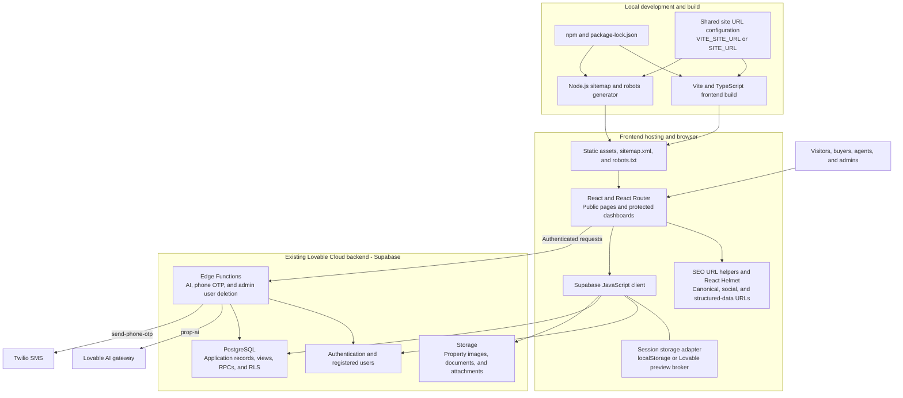

# PROP-CONNECT

PROP-CONNECT is a real-estate platform for finding and verifying properties in
Nigeria. The frontend is built with React, TypeScript, Vite, and Tailwind CSS.

## Architecture

The diagram shows the current application and build pipeline. The existing
Lovable Cloud backend remains connected; an independent Supabase project is
not yet part of the deployed architecture.



Frontend hosting and SEO configuration are separate from backend migration.
The sitemap generator uses static public routes and makes no database requests.
Service-role and external-service secrets stay in the server-side environment;
they are not part of the browser bundle. Client route guards control navigation,
while database policies and server-side checks enforce access to backend data.

## Development

Requirements: Node.js and npm. Bun is not required.

Use npm and the committed `package-lock.json` for dependency management.

```sh
npm ci
npm run dev
```

The dev and build lifecycle scripts generate `public/sitemap.xml` and
`public/robots.txt` with Node.js.
No additional JavaScript runtime is required.
The development server uses port `8080` by default.

| Command | Purpose |
| --- | --- |
| `npm run dev` | Start the development server |
| `npm test` | Run the test suite once |
| `npm run test:watch` | Run tests in watch mode |
| `npm run lint` | Run ESLint |
| `npm run build` | Build production assets in `dist/` |
| `npm run build:dev` | Build using Vite's development mode |
| `npm run preview` | Preview the built application locally |

## Validation and production build

```sh
npm test
npm run lint
npm run build
```

Run TypeScript checks separately; a Vite build does not replace type checking:

```sh
npx --no-install tsc --noEmit -p tsconfig.app.json
npx --no-install tsc --noEmit -p tsconfig.node.json
```

## Backend configuration

The app continues to use its existing Supabase project for authentication,
database, storage, and Edge Functions. Configure the existing
`VITE_SUPABASE_PROJECT_ID`, `VITE_SUPABASE_URL`, and
`VITE_SUPABASE_PUBLISHABLE_KEY` variables in the local environment. Do not put
service-role keys or other secrets in frontend environment variables.

The existing Lovable Cloud backend remains in use until the independent
Supabase migration is complete. Preserve its configuration to retain access to
registered users, application records, and stored files. A frontend domain
change does not transfer users or data to another Supabase project.

## Website URL and SEO

Set `VITE_SITE_URL` to the public website origin, for example
`https://www.example.com`. Leave it unset to retain the existing production
website. Setting `VITE_SITE_URL` alone is sufficient for frontend metadata and
the Node.js generator; backend environment variables do not need to change.

The shared resolver in `config/site-url.mjs` is used by frontend SEO helpers,
Vite HTML metadata, and the sitemap/robots generator. `SITE_URL` is supported as
an alternative for Node and Vite; if both variables are set, they must agree.
Use an HTTP(S) origin without credentials, a subpath, query, or fragment.
Trailing slashes are normalized. This is public configuration, never a secret.

| File | Responsibility |
| --- | --- |
| `config/site-url.mjs` | Shared fallback, validation, and absolute URL construction |
| `src/lib/seo.ts` | Frontend canonical, social, and image URL helpers |
| `src/components/SeoDefaults.tsx` | Route-aware social defaults that page metadata can override |
| `vite.config.ts` | Mode-aware configuration and HTML URL substitution |
| `index.html` | Initial social metadata and organization/website structured data |
| `scripts/generate-sitemap.mjs` | Sitemap and robots generation |

Vite mode-specific environment files are supported. `npm run dev` and
`npm run build` regenerate SEO files; direct Vite commands also regenerate them
for the selected mode. To generate independently:

```sh
node scripts/generate-sitemap.mjs --mode production
```

At domain cutover, set `VITE_SITE_URL` in the hosting/build environment and
rebuild. Verify the built sitemap, robots file, canonical URLs, structured data,
and `/social-preview.jpg`. The preview image is a copy of the existing
PROP-CONNECT logo, replacing the externally hosted editor preview screenshot.
Production hosting, redirects, backend CORS, and authentication allowlists need
separate review before switching traffic; this change does not alter them.

The sitemap includes 14 public static pages, including trust pages. Authentication,
account, chat, dashboard, and admin routes are excluded. Robots allows public
crawling; exclusion from the sitemap does not prevent indexing or grant access.
No speculative priority, change frequency, or last-modified dates are emitted.

The included routes are `/`, `/properties`, `/agents`, `/announcements`,
`/analytics`, `/guides/investing-in-nigeria`, `/terms`, `/privacy`, and the six
public `/trust/` pages: `safety-center`, `escrow-protection`,
`agent-verification`, `property-verification`, `fraud-prevention`, and
`code-of-conduct`.

Update the generator rather than manually editing generated output. Development
and build commands overwrite `public/sitemap.xml` and `public/robots.txt`.

### Dynamic property and agent sitemap entries

Routes `/property/:id` and `/agent/:id` already exist. The frontend reads
properties and the `public_profiles` view, but repository migrations alone do not
prove the deployed anonymous-access policies or all publication requirements.
No database requests or dynamic IDs are added by this generator.

Before adding dynamic entries, provide an audited anonymous public feed that
returns only eligible page IDs and optional genuine public-content update times.
Property eligibility must explicitly exclude draft, payment-pending, unpublished,
and otherwise private records. Agent eligibility must require a visible public
agent profile. Use only the minimal fields, not names, email addresses, phone
numbers, account IDs, or entire profile objects. Verify anonymous access and
pagination against the deployed policies; never use service-role credentials or
an authenticated user's session in a build. Then generate only
`/property/<encoded-public-id>` and `/agent/<encoded-public-id>` URLs using the
same URL helper, and refresh the sitemap when public content changes. Keep the
static sitemap available if the public feed is unavailable.

This frontend upgrade does not create the feed, change database policies, or
modify Supabase, authentication, Edge Functions, or migration history.

## Independent domain cutover

When the new production domain is available:

1. Set `VITE_SITE_URL` in the hosting/build environment.
2. Run TypeScript checks, tests, and `npm run build`.
3. Verify `dist/sitemap.xml`, `dist/robots.txt`, HTML structured data, canonical
   and social URLs, and `dist/social-preview.jpg`.
4. Separately validate hosting redirects, SPA route handling, backend CORS, and
   authentication redirect allowlists before switching traffic.
5. Verify public pages, property and agent links, login, and Edge Function calls
   on the new host before retiring the old host.

## Remaining Lovable integrations

Lovable development tagging is absent from the active npm manifests and Vite
plugins. The following integrations remain for the current environment:

| File | Remaining integration |
| --- | --- |
| `config/site-url.mjs` | Temporary production URL fallback, also used in generated SEO files |
| `src/integrations/supabase/previewAuthStorage.ts` | Preview session broker imported by the Supabase client |
| `supabase/functions/_shared/cors.ts` | Existing production and preview origins |
| `supabase/functions/prop-ai/index.ts` | Lovable AI gateway and server-side `LOVABLE_API_KEY` |
| `drizzle.config.ts` | `LOVABLE_DB_MIGRATION_URL` for migration tooling |

Preserve these integrations and the existing Supabase connection until their
replacements are verified. Keep all SQL migrations, Drizzle snapshots, and the
migration journal as database history.
